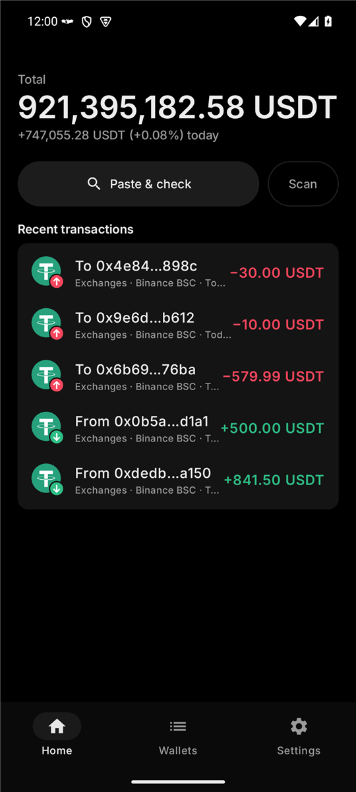
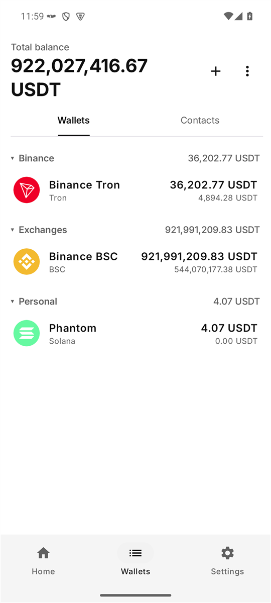
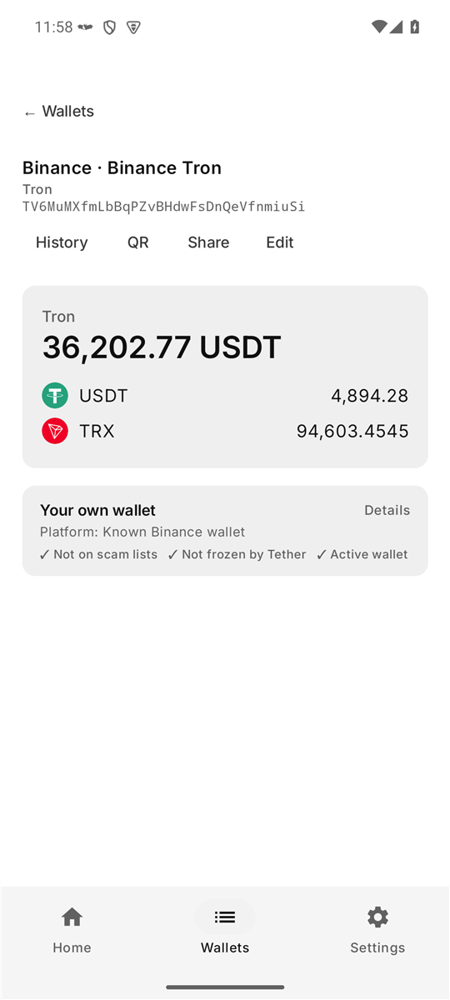
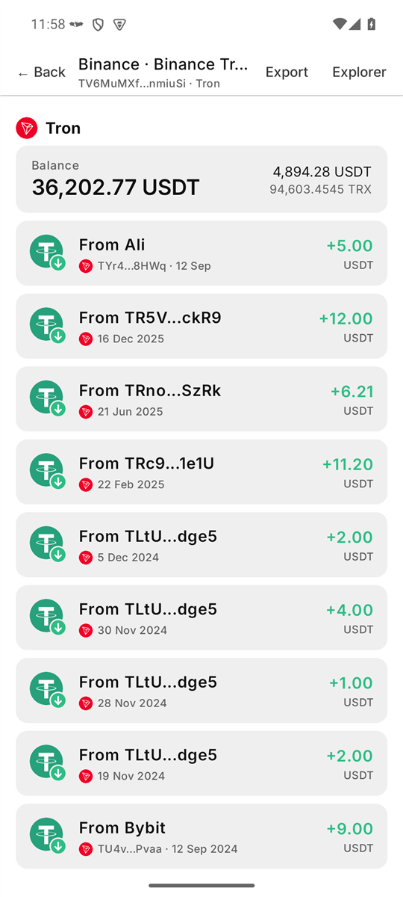
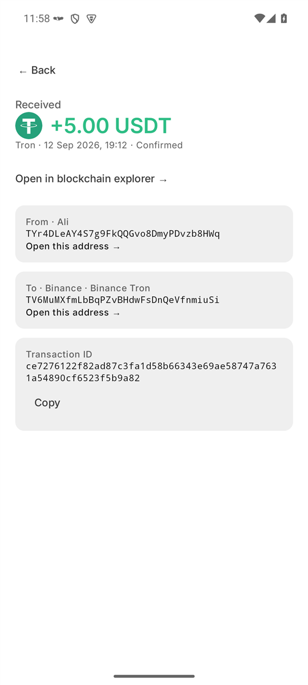
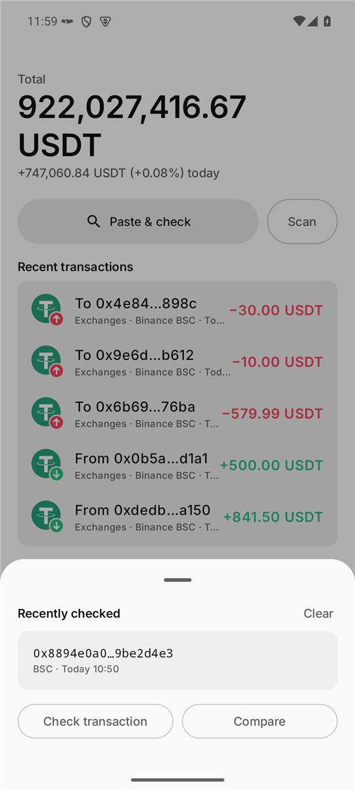
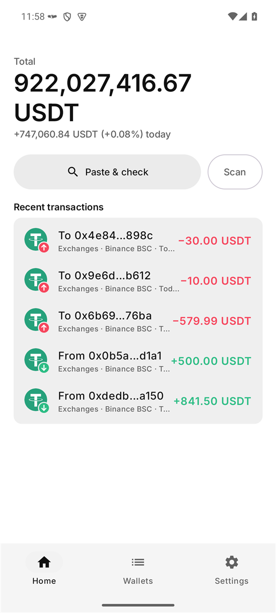
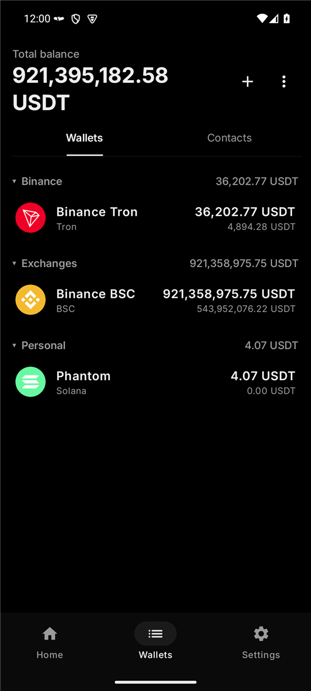
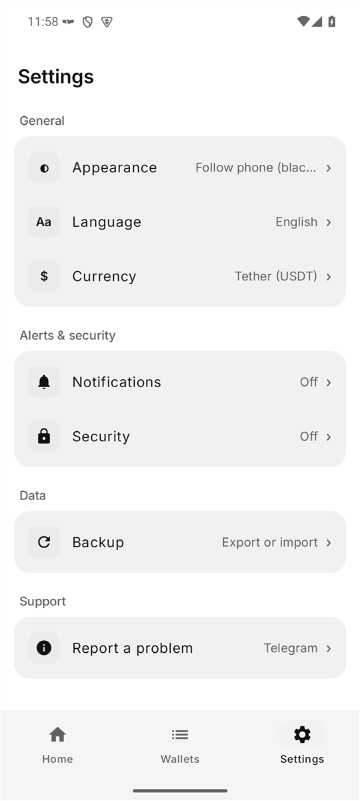

# Batwallet

A minimalist, **read-only** Android crypto wallet viewer. Paste, share or scan any wallet address and it
detects the network, shows balances (USDT-focused), history and safety checks. It never asks for
private keys and can't move funds.

Made by [@MalluWayne](https://t.me/MalluWayne) with Claude.

## Screenshots

<table>
  <tr>
    <td align="center"> Home (black theme)</td>
    <td align="center"> Wallets & folders</td>
    <td align="center"> Wallet + safety check</td>
  </tr>
  <tr>
    <td align="center"> History</td>
    <td align="center"> Transaction details</td>
    <td align="center"> Recent checks & tools</td>
  </tr>
  <tr>
    <td align="center"> Home (white theme)</td>
    <td align="center"> Wallets (black theme)</td>
    <td align="center"> Settings</td>
  </tr>
</table>

Screenshots use public exchange addresses as examples, which is why the totals are so large - im poor .

## Features

### Check any address
- **~30 networks**: Tron (TRC20), BSC (BEP20), Ethereum (ERC20), Polygon, Arbitrum, Optimism, Base, Avalanche, Celo, Sonic, Ethereum Classic, VeChain, TON, Aptos, Solana, Bitcoin, Bitcoin Cash, Litecoin, Dogecoin, XRP, Cardano, Polkadot, Cosmos, Stellar, Algorand, NEAR, Tezos, EOS
- **Detects the network** from the address; for a 0x address you pick BSC, Ethereum, … (or all)
- **Smart paste**: copy a whole chat message and Batwallet finds the address in it. Words like "BEP20" or "ERC20" pick the network for you
- **Share → Batwallet** from Telegram, a browser or any app
- **QR codes** with the camera, or from a saved photo or screenshot
- **Safety check** before you send: scam databases (GoPlus), Tether freeze list, smart contracts, new or unused addresses, known exchange wallets
- **Lookalike warning**: flags addresses made to look like yours (address poisoning) and hides dust transfers used for it

### Your wallets
- **Saved wallets and contacts** with folders (e.g. Binance, Trust Wallet), notes and pinning
- **Drag to reorder**, sort by value or name, search, archive, select several to move or delete
- **Duplicate check** so the same address isn't saved twice
- **Balances in USDT** by default, or in $, ₹, €, £, AED, ₼ or ₽, with today's change
- **Low-gas warning** when one of your own wallets holds USDT but not enough TRX / BNB / ETH to send it (not shown for exchange wallets, which pay their own fees)

### History & transactions
- **Transfers per network** with the other side named (your wallets, contacts, known exchanges) and friendly dates
- **Follow the money**: tap any address in a transaction to open it
- **Check a transaction ID** on EVM chains, Tron, Aptos, TON, Bitcoin, Litecoin or Solana: amount, from, to and status
- **Compare two addresses** character by character
- **Export history** as CSV, or open it in the blockchain explorer

### Alerts
- **Instant** (every 30 s) or **battery saver** (every 15 min, and every 30 s while charging)
- **Minimum amount** and **big-payment** alerts (louder, longer vibration)
- **Daily summary** at 9 AM with your total and today's change
- Notifications name the wallet (folder · name), never the address

### Privacy & security
- **Read-only**: no private keys, no seed phrases, can't move funds
- **Fingerprint lock** (or phone PIN) with auto-lock time and lock on screen off
- **Hide balances** with a tap; showing them again asks for your fingerprint
- **Backups** to a file, optionally protected with a password (AES-256-GCM)
- No account, no server, no ads, no tracking

### Look & feel
- Black (OLED) or white theme, or follow the phone
- English, Русский and हिन्दी
- Swipe between Home, Wallets and Settings; short tips the first time you open each tab

## How to use

1. Install the APK and open Batwallet.
2. Copy a wallet address (or a whole message containing one) and tap **Paste & check**, or tap **Scan**.
3. Tap **Save** on the result to add it to your wallets, or long-press **Paste & check** for recent checks, transaction lookup and address compare.
4. Turn on **Settings → Notifications → Payment alerts** to hear about payments.
## Download

Get the APK from the [Releases](../../releases) page and install it on Android 9 or newer.

## Privacy

There's no account and no server. Wallets and settings stay on the phone. The app only asks public
blockchain services (and price feeds) about the addresses you look up.

## Build

1. Install Android Studio (or the Android SDK) and JDK 21.
2. Create `local.properties` in this folder with your SDK path, e.g.
   `sdk.dir=C\:\\Users\\YOU\\AppData\\Local\\Android\\Sdk` (Windows) or `sdk.dir=/home/you/Android/Sdk`.
3. Build: `./gradlew assembleRelease` (Windows: `gradlew.bat assembleRelease`).
   The APK lands in `app/build/outputs/apk/release/`.
   Release builds use R8 (minify + shrink) and are signed with the **debug** key, so every build can
   update the previous install on the same PC. A different PC has a different debug key: uninstall
   first (export a backup in Settings before that), or set up your own release signing.
   Never commit a signing key: `*.jks` / `*.keystore` are in `.gitignore`.

`applicationId` is `com.malluwayne.batwallet`; the Kotlin package / namespace is still `com.example.walletlookup`.

## Source map (`app/src/main/java/com/example/walletlookup/`)

| File | What it does |
|---|---|
| `MainActivity.kt` | Theme, fingerprint lock, `App()` state, Home / Wallets / Settings tabs (swipeable), dialogs, drag-to-reorder, first-run tips |
| `Lookup.kt` | Address detection (~30 networks), smart-paste extraction, balance lookups, prices (CoinMarketCap → Binance → Bybit → CoinGecko), currencies (`Fiat`), formatting, explorer links, `http()` |
| `Insights.kt` | Transaction history per network, safety checks (GoPlus, Tether freeze, contract, activity), cached log-scan history for BSC / Polygon / Arbitrum / Base / Sonic |
| `Extras.kt` | History for BTC, LTC, BCH, DOGE, XRP, Stellar, Algorand, Tezos, Solana; native-coin transfers; other tokens |
| `InsightsUi.kt` | History screen, transaction detail screen, safety card |
| `HomeExtras.kt` | Home sections: recent transactions, activity, recently checked, other tokens |
| `TxLookup.kt` | Find a transaction by its ID (EVM chains, Tron, Aptos, TON, Bitcoin, Litecoin, Solana) |
| `Tools.kt` | Address chooser, Check transaction and Compare addresses dialogs |
| `Alerts.kt` | Payment alerts: WorkManager (15 min), charging job (30 s), foreground `WatchService` (instant, 30 s), daily summary, big-payment and low-gas alerts |
| `Store.kt` | SharedPreferences store: saved wallets (`SavedAddress`), caches, settings, backup export/import, name labels |
| `BackupCrypto.kt` | Password-protected backups (PBKDF2 + AES-256-GCM) |
| `Platforms.kt` | Known exchange hot wallets (Binance, Bybit, OKX, …) and exchange-wallet detection |
| `Share.kt` | Share text + branded QR card image, CSV export |
| `Scanner.kt` | QR scanner (camera and imported photo), crisp square QR generation |
| `Logos.kt` | Coin / network logos, in/out colours |
| `I18n.kt` | Languages (English / Russian / Hindi) via `res/raw/i18n.tsv`, first-run tips |
| `BatText.kt` | App-wide `Text()` wrapper that translates every label (screens don't import material3 `Text`) |
| `BatApp.kt` | Crash handler that saves the last crash report |

Resources: `res/drawable-nodpi/coin_*.png` (CC0 cryptocurrency-icons), `res/drawable/coin_ton.xml` and `coin_apt.xml`,
`res/font/inter_*.ttf`, `res/raw/i18n.tsv` (tab-separated: English, Russian, Hindi).

## Conventions and gotchas

- Addresses can carry a network tag: `0xabc…@BSC`. Use `rawAddress()`, `netOf()`, `withNet()`, `labelOf()`.
- Adding a UI string: write it in English inside `Text("…")`, then add a line to `res/raw/i18n.tsv`.
- R8 is on: `proguard-rules.pro` keeps Room/WorkManager classes. Removing those rules makes the app crash on launch.
- Solana's public RPC rejects batched requests — keep those calls unbatched.
- Etherscan's free API key no longer covers BSC, Polygon, Arbitrum or Base; those use cached `eth_getLogs` scans of public nodes (`LOG_NODES` in `Insights.kt`).
- Version is set in `app/build.gradle.kts` (`versionCode` / `versionName`); Settings shows it automatically.
- Files are UTF-8 (no BOM). Some strings contain ₹, ₼, ↓, ♥ and Cyrillic / Devanagari text.

## License and credits

- Code: [MIT](LICENSE) © 2026 MalluWayne
- Font: [Inter](https://github.com/rsms/inter) by The Inter Project Authors, [SIL Open Font License 1.1](licenses/Inter-OFL.txt)
- Coin icons: [cryptocurrency-icons](https://github.com/spothq/cryptocurrency-icons), CC0 1.0 (public domain)
- QR codes: [ZXing](https://github.com/zxing/zxing) / [zxing-android-embedded](https://github.com/journeyapps/zxing-android-embedded), Apache 2.0
